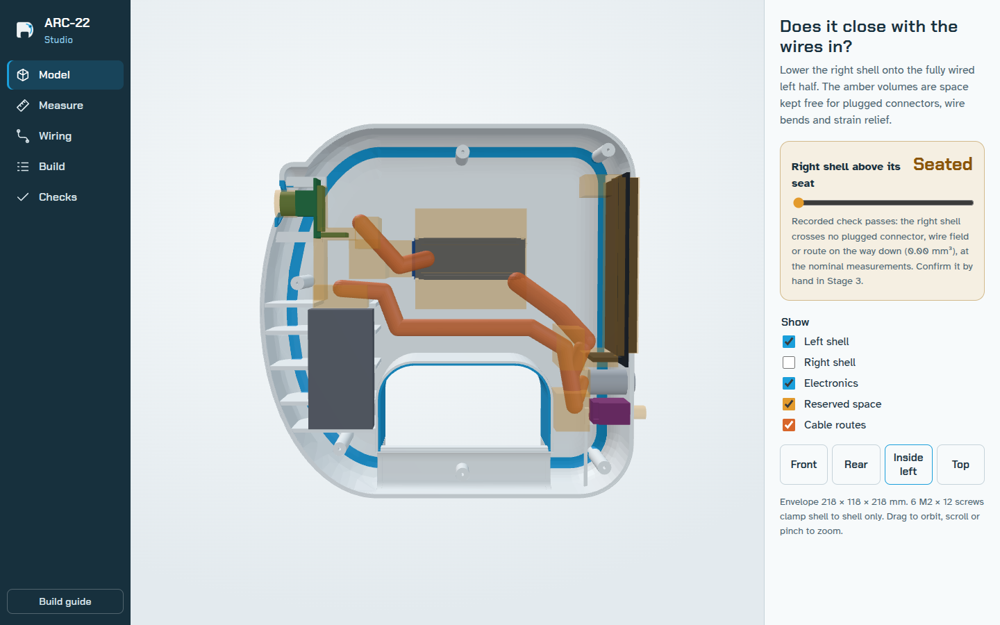

# ARC-22 Studio — the web and desktop app

One app, two forms, same code (`docs/app/`):

- **Web:** `https://<you>.github.io/arc22-scanner/app/`. Works on a phone. In Chrome or Edge choose **Install app** (left rail, or the install icon in the address bar) to get it as a standalone window that keeps working offline.
- **Desktop:** download from the repository's **Releases** page — Windows installer or portable `.exe`, macOS `.dmg`, Linux `.AppImage` or `.deb`. Everything is inside the app; no internet needed.

## What it does
| View | Use it to |
|---|---|
| **Model** | orbit the scanner, show/hide each shell, the electronics, the amber **reserved space** for plugged connectors and wire bends, and the cable routes. Drag *Right shell above its seat* to lower the right shell onto the wired left half; at 0 it shows the recorded closing check |
| **Measure** | type your caliper measurements (60 values, grouped by part), see how many are still reference values, and **Download my_units.toml** for `measurements/`. You can also load an existing file |
| **Wiring** | the pin map read from `firmware/main/pins.h`, the power path and the programming sequence |
| **Build** | mark stages 0–7 PASS, FIX or STOP with notes, and download them as a table for `docs/VALIDATION.md` |
| **Checks** | every recorded CAD and mesh check, with a filter for failures |

Your measurements and build notes are stored only in this browser or this desktop app on this computer. Download them to keep them.

## Where the data comes from
`bash scripts/rebuild_all.sh` ends with `tools/build_web_data.py`, which writes `docs/app/models/` (web meshes in assembly coordinates) and `docs/app/data/` (parameters, pins, checks) from the same CAD build and firmware sources as everything else. Commit and push, and both the web app and the next desktop release pick it up.

## Opening an unsigned installer
The installers are built by GitHub Actions but not code-signed (that needs paid certificates).
- **Windows:** "Windows protected your PC" → *More info* → *Run anyway*.
- **macOS:** right-click the app → *Open* → *Open*. The macOS build is for Apple-silicon Macs.
- **Linux:** `chmod +x ARC-22-Studio-*.AppImage` then run it, or `sudo apt install ./ARC-22-Studio-*.deb`. On Ubuntu 24.04+ AppImages also need `sudo apt install libfuse2t64`.

Check a download against `SHA256SUMS.txt` from the same release: `sha256sum -c SHA256SUMS.txt --ignore-missing`.

## Privacy and security
No accounts, analytics or network calls: the app only loads its own files (enforced by a Content Security Policy). The desktop app runs with context isolation and the sandbox on, no Node.js in the page, refuses all permission requests, and opens outside links in your normal browser.
