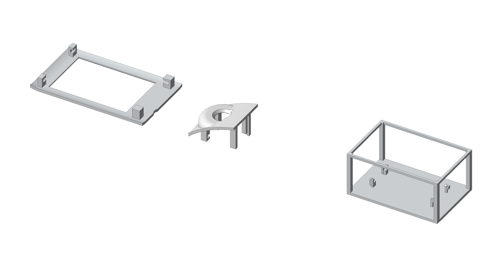

# Build guide — the spine of ARC-22 FitFirst

Every other document hangs off this one. Work through the stages **in order**. Each stage lists the parts, the steps, what to measure, and three outcomes:

- **PASS** — go to the next stage.
- **FIX** — change a named value in `measurements/my_units.toml` (or a design value), run `bash scripts/rebuild_all.sh`, repeat the stage.
- **STOP** — do not continue; something is wrong enough that continuing wastes plastic, parts or a battery.

> **Status of this design.** The Computer-Aided Design (CAD) model passes its own recorded checks, but **nothing physical has been verified**: not the fit, not the slicing, not the firmware on hardware. Read [VALIDATION.md](VALIDATION.md). This guide is how *you* do that verification. Never call a build perfect-fit, fully tested or waterproof.

**Why this design exists.** Earlier versions passed CAD checks with plain blocks for the boards, then did not fit the real boards *with their jumpers plugged in*. ARC-22 models every board as its populated circuit board **plus** solder, pin projection, the plugged-in 2.54 mm Dupont housing, a straight wire exit, the first relaxed bend and strain relief ([CAD.md](CAD.md)). Boards seat snug on soft pads at bare corners; wires stay free to move.

---

## Stage 0 — Measure your exact parts

A family name is not a dimension: two "ESP32-S3-N16R8" boards or two "4.0 inch ST7796S" modules can differ by millimetres.

**Parts:** display, camera, ESP32-S3 board, the actual Dupont jumpers you will use (plugged in), latching button, charger board, battery. **Tools:** digital calipers, phone camera, a ruler for photos.

**Steps**
1. Photograph each board from the front, back and each edge, with a ruler in frame. Save photos in `measurements/photos/` (keep them local if you prefer).
2. Copy `measurements/my_units.toml.example` to `measurements/my_units.toml`.
3. Measure every item in [MEASUREMENTS.md](MEASUREMENTS.md) and enter it under `[measured]`. The important ones:
   - display: printed circuit board (PCB) width/height/thickness, glass outline and its offset from the PCB, active-area offset, glass stack height, tallest back-side part, header edge and pin count, **bare PCB at each corner (front and back)**;
   - camera: PCB size, lens diameter and how far it projects, optical-centre offset, header position and direction (pins pointing back or down), **Mini vs Mini Plus** (printed on the board);
   - ESP32-S3: length/width, tallest top-side part, USB-C overhang and how many USB ports, header row position, **which corners are bare**;
   - Dupont: housing length on the pin, the straight length before the wire can bend, the first *relaxed* bend radius of a bundle;
   - USB-C programming cable: overmold width and thickness;
   - button: body depth incl. terminals and solder; charger: size, USB-C position, bare corners; battery: size.
4. Run `bash scripts/rebuild_all.sh`. The build prints every value still marked VERIFY.

**PASS** all values that affect fit are measured and the rebuild reports 0 failed checks.
**FIX** a check fails → read the failing row in [docs/validation/cad_checks.md](validation/cad_checks.md), relocate the part or change a design value; never scale the scanner.
**STOP** your camera is an ESP32-CAM, a bare OV2640 ribbon or an Arducam Mega; your display is not ST7796S + XPT2046; your battery is not a protected 1S cell — this design does not apply.

---

## Stage 1 — Print the three fit samples (100 %)

**Parts:** `cad/out/fit_samples/` — `01_SCREEN_76x124_BEZEL_AND_PADS`, `02_CAMERA_46x50_LENS_AND_PADS`, `03_ESP32_WIRED_100x66x44_GAUGE`. One colour, PETG, settings from [PRINTING.md](PRINTING.md). They are test pieces, never installed.

**Steps**
1. Print all three at 100 % scale (check the slicer did not rescale).
2. **01 screen:** lay the display in from the open side: PCB corners slide into the four corner slots with foam on both jaws. Look through the window: the active area is centred and no edge of the glass touches plastic.
3. **02 camera:** slide the camera into the corner slots; the lens sits centred in the aperture with an even gap all round and does not rub when you wiggle the board.
4. **03 ESP32 gauge:** press the board onto the pads until the four clips snap (gently). **Now plug in every jumper you will use**, bend the bundles the way they will run, and check they stay inside the frame without forcing.
5. Check the wired fit **separately** from the thin frames: a frame that flexes can hide a clash.

**Measure** gaps with feeler gauges or paper strips: glass-to-wall, lens-to-aperture, plug-to-frame.

**PASS** every board seats snug, cannot rattle or fall out, nothing touches glass or lens, all plugs and bends fit.
**FIX** loose or tight → adjust the measured value (not a fudge factor), rebuild, reprint the sample.
**STOP** hard contact on a component, glass interference, frame flex needed to close, blocked connector, lens rubbing.

---

## Stage 2 — Clearance, insertion and closing checks (CAD)

**Steps**
1. `python cad/validate_arc22.py` (already part of the rebuild).
2. Read [docs/validation/cad_checks.md](validation/cad_checks.md). It checks every hard part and every reserved wire field against both shells, module-to-module room, the **insertion path** of each module, and the **closing swept volume** of the right shell descending onto the fully wired left half — not just final positions.
3. Look at [the reserved fields render](img/arc22_fields.png) and [sections](img/arc22_section_seam.png).

**PASS** 0 failed. **FIX** any FAIL. **STOP** if you would have to remove a wire field or a strain-relief allowance to make it pass — that is the exact mistake ARC-22 exists to prevent.

---

## Stage 3 — Print the shells, dry-fit empty, then fully wired

**Parts:** LEFT and RIGHT shells (two-colour, [PRINTING.md](PRINTING.md)), 6 × M2 × 12 screws, foam pads.

**Steps**
1. Print LEFT and RIGHT. Inspect for stringing inside slots and clips; clear support from every slot.
2. **Empty dry-fit:** put the halves together by hand. The lip on the LEFT seam must enter the RIGHT groove all the way round with no force. No screws yet.
3. Stick 0.5–1 mm non-conductive foam on every pad and slot jaw.
4. **Install into the LEFT shell (it lies on its side, seam up):** display (slides into its corner slots), camera, ESP32 (press until the clips click), battery (lay into the rib cradle), charger (into its corner slots, USB-C lined up behind the port), button (through the rear panel, nut inside). See [WIRING.md](WIRING.md).
5. Plug every Dupont lead, dress bundles into the reserved routes ([interior render](img/arc22_left_interior.png)), restrain with soft removable ties or tape — never pinch a bundle under a rib.
6. **Fully wired dry-fit:** lower the RIGHT shell straight down. It must close with **gentle hand pressure before any screw**.
7. Only then fit the six M2 × 12 screws (slim driver, ≥ 60 mm shaft, ≤ 4 mm diameter; the wells are deep). Snug, not tight — they clamp shell to shell, never a module.

**PASS** closes by hand, no creak/press on any board, nothing rattles when shaken gently.
**FIX** a bundle needs re-dressing → re-route; a slot is tight → foam thickness or measured value.
**STOP** it only closes with force, or a screw is needed to pull the halves together.

---

## Stage 4 — Bench commission (power, display/touch, camera) — `COMMISSION_CAPTURE_ONLY`

Do this on the bench with the case **open**. Read [SAFETY.md](SAFETY.md) first.

**4a Power** (no ESP32 connected yet — RUN pigtail unplugged)
1. Battery → charger battery JST. Charge from the **charger's** USB-C. Check charge LED behaviour.
2. Meter the charger 5 V output with the button OPEN (output on) and CLOSED (output off).
3. Plug the RUN pigtail; with the system load connected, measure startup behaviour, peak current during Wi-Fi + detection later, and board temperature.

**4b Display + touch** — flash the commissioning firmware ([FIRMWARE.md](FIRMWARE.md)). Programming sequence: **turn off → unplug charging USB → unplug RUN → connect computer USB to the ESP32**.
- Page 1: colour bars in the stated order, arrow points to the top of the scanner. Calibrate touch (tap the arrow tips).
- Page 2: draw — the dot follows your stylus everywhere, including corners.

**4c Camera** — page 3 shows SPI OK, I2C OK, OV2640 ID, and a live still loop: image upright, the right way round, in focus at arm's length (turn the S-mount lens to focus, then lock it).

**PASS** all three; supply stays in range with no brown-out resets.
**FIX** rotation/colour → `ARC_LCD_ROTATION`, `invert`, `rgb_order`; image upside down → `ARC_CAM_FLIP_180`; SPI/I2C fail → wiring, pull-ups, camera VCC ([WIRING.md](WIRING.md)).
**STOP** anything gets hot, the charger output collapses at start-up (its boost converter can stall above ~200 mA when switched on into a load), the cell swells or smells.

---

## Stage 5 — Enable local inference

1. `idf.py menuconfig` → *ARC-22 scanner* → untick *Commissioning mode* (or set `CONFIG_ARC_COMMISSION_CAPTURE_ONLY=n`), rebuild, flash (full flash includes the model partition).
2. Aim at a cup, bottle, keyboard or chair (they are among the 80 COCO categories). Tap **SCAN**. The radio is off; a still is captured and detection runs **on the ESP32-S3**. Expect several seconds — Espressif lists about 6.2 s for this model alone on an ESP32-S3; your full time is unmeasured until you measure it.
3. Boxes and names appear. Tap a box (or a list row) to select it, then **LEARN** for the Wikipedia intro. Without Wi-Fi it shows a QR code; **GOOGLE** shows a search QR.

**Measure** decode and detection time (shown on screen and in the serial log), PSRAM free before/after.
**PASS** boxes line up with objects, selection works, article or QR appears, no reset.
**FIX** boxes offset → orientation settings; nothing found → light, distance, `ARC_SCORE_THRESHOLD_PCT`.
**STOP** resets during detection (power), or detection needs the network (it must not).

---

## Stage 6 — Monitored closed-case run

1. Close the case (stage 3 rules). Run 20 scan + lookup cycles over ~30 min while charging is **not** connected.
2. Every 5 minutes note case temperature near the ESP32 and charger (finger test + an infrared thermometer if you have one).
3. Then one full charge cycle with the case closed, monitored.

**PASS** no resets, no hot spots, charge completes (the charger has a fixed 6 hour safety timer — a large cell can hit it).
**STOP** any resets, smell, heat you cannot keep a finger on, or swelling.

---

## Stage 7 — Update the files and tell the truth

1. Commit your `measurements/my_units.toml` (optional), photos, and the regenerated outputs.
2. Update [VALIDATION.md](VALIDATION.md): move each PHYSICAL item you actually tested from *unverified* to *verified on <date> with <part numbers>*, and record what failed.
3. Keep the words "perfect fit", "fully tested" and "waterproof" out of your notes. Enclosed is not waterproof; ARC-22 has no Ingress Protection (IP) rating.
