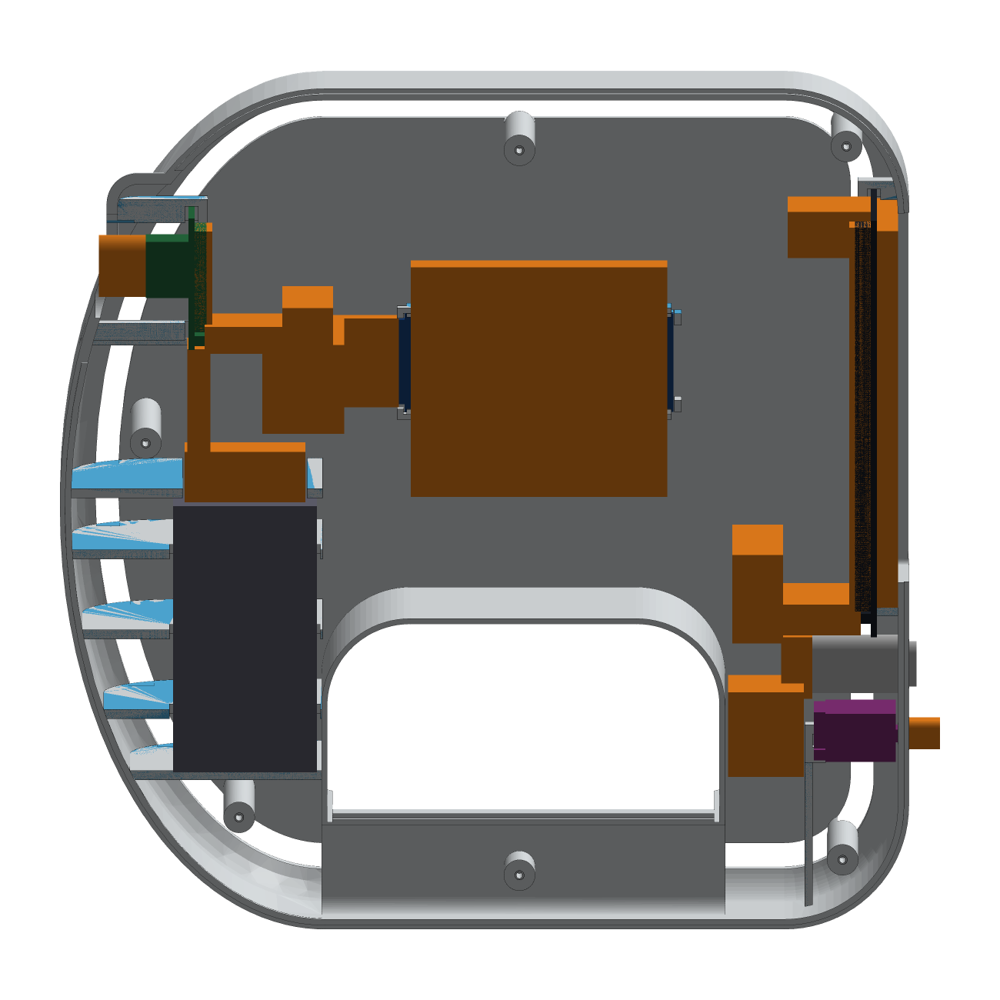

# CAD — how the model is built and checked

The enclosure is code: **CadQuery** (a Python library on top of the OpenCascade kernel) builds both shells from named parameters. Nothing is drawn by hand, so every output can be regenerated after you change a measurement.


## Rebuild order
```bash
python -m pip install -r cad/requirements.txt
bash scripts/rebuild_all.sh
```
which runs, in order:

| Step | Script | Produces |
|---|---|---|
| 1 | `cad/build_arc22.py` | LEFT/RIGHT shells, WHITE/BLUE regions, modules, wire fields, routes → `cad/build/*.brep` (cache) |
| 2 | `cad/validate_arc22.py` | recorded checks → [docs/validation/cad_checks.md](validation/cad_checks.md) |
| 3 | `cad/export_arc22.py` | STEP, OBJ+MTL, aligned STL regions, 3MF, reference CAD, [mesh checks](validation/mesh_checks.md) |
| 4 | `cad/fit_samples_arc22.py` | the three print-first fit samples |
| 5 | `cad/render_arc22.py` | the images in `docs/img/` |

All dimensions live in `cad/arc22_params.py`; geometry in `cad/arc22_geometry.py`.

## Coordinate systems — never mix them
- **Assembly coordinates** (STEP, BREP, every check): X front-back (0 = rear face, + toward the bow and camera), Y width (seam at Y = 0, LEFT is Y < 0), Z up (0 = bottom of the grip). Bounds 218 × 118 × 218 mm.
- **Print coordinates** (STL/OBJ/3MF): one transform **per shell** (`cad/out/print/PRINT_TRANSFORMS.json`), applied identically to that shell's WHITE and BLUE regions. To add an accent, add it to `accent_tool()` in assembly coordinates and rebuild — never edit a printable mesh.

## The shape
A D-shaped silhouette: straight rear housing with the rear-facing touchscreen, straight top, elliptical front bow, and an **integrated camera fairing** (a nose blended into the upper bow — no pod, neck or gap). Rounded shoulders (28 mm) on both faces. A central **hand loop** goes through the body; its walls are 2.8 mm all round so it never opens into the electronics cavity. A narrow rounded **grip bar** (38 × 30 mm, 12 mm radii) runs under the loop. Only functional openings exist: touch window, lens aperture, power button, charger USB-C (with an overmold recess), six screw wells, and the hand loop.

The large head is a fit-first compromise. To improve ergonomics, relocate parts or reshape non-critical regions — **never** scale the scanner or take space from a module or a wire field.

## Fit model (the point of ARC-22)
Each module (`arc22_geometry.py`) has three kinds of geometry:

| Kind | Contains | Rule |
|---|---|---|
| **hard** | populated PCB, glass, lens/holder, tallest parts on each face, header + pin projection, **plugged-in Dupont housings**, USB connectors | no plastic may intersect it — at rest **or while being inserted** |
| **field** | straight wire exit + first relaxed bend + strain relief behind every header (display header, both ESP32 rows, the camera row pointing back **or** down), open backs, the USB-C programming corridor, glass air gap, lens air gap | no plastic may intersect it |
| **bare** | corners/edges you verified have no parts | the only places a support may touch |



### Retention — gentle, never screw pressure
- **Display:** four corner slots (front jaw on the bare PCB margin outside the glass, back jaw on the bare back corner, side and end stops), foam on both jaws, open toward the seam so the board lays in. Nothing touches the glass; the back is open.
- **Camera:** top corners full slots; bottom corners front jaw + side stop only (the 8-pin header sits there); slots tethered to the bow wall; the lens floats in its aperture with 1 mm clearance.
- **ESP32-S3:** stands on edge in the LEFT shell, component side to the wall. Pads only on the bare corners at the antenna end, four lay-in snap clips on the long edges beyond the header ends, end stops; the USB end has no pad (connectors/buttons there). Both header rows face the open interior with their full wire field.
- **Battery:** foam-lined rib cradle (floor, three side ribs, top tabs leaving room for the leads).
- **Charger:** two front corner slots; the USB-C receptacle lines up flush behind the port.
- Screws (M2 × 12, six) clamp **shell to shell only**; the recorded check confirms every boss is clear of every module.

### Seam
The LEFT shell has a 1.6 mm lip on the inner part of the wall; the RIGHT shell has a matching groove with 0.2 mm clearance. It locates the halves and hides the seam line. There is no lip across the camera nose.

## Recorded checks (`validate_arc22.py`)
Envelope and bed fit · one valid solid per shell · every hard part and field vs both shells · module-to-module room · **insertion path** of each module swept in 1 mm steps along its real install path · **closing swept volume** of the RIGHT shell descending onto the fully wired LEFT half (plugs, fields and routes included) · cable routes inside the cavity · hand loop sealed · screw bosses clear of modules, pilot holes blind · WHITE + BLUE regions rebuild each shell exactly.

These are self-consistency checks with nominal numbers. They do not replace Stage 0–3 of the [build guide](BUILD_GUIDE.md).

## Reference CAD (`cad/reference_cad/`, not printable, not vendor models)
`ARC22_REFERENCE_MODULES.step` (simplified PCBs, glass, lens, headers, plugs, battery, charger, button), `ARC22_CLEARANCE_FIELDS.step`, `ARC22_WIRE_ROUTES.step`, `ARC22_TOPOLOGY.step` + `topology.json` (which module connects to which, and with what signals).

## Fit samples
`01_SCREEN_76x124_BEZEL_AND_PADS` and `02_CAMERA_46x50_LENS_AND_PADS` are cut straight from the real shells. `03_ESP32_WIRED_100x66x44_GAUGE` is the side-wall plate with the ESP32 pads/clips plus an open 44 mm frame outlining the reserved plugged-wire volume. See Stage 1.


