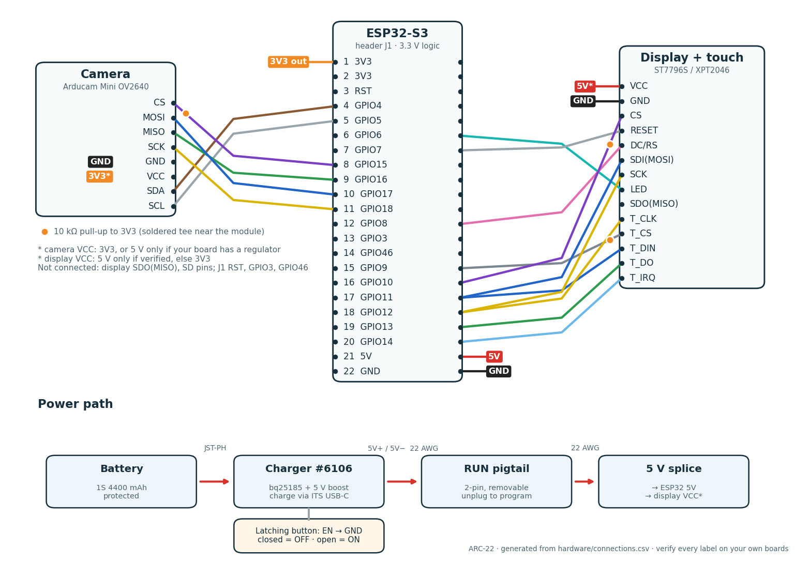

# Pin-by-pin connections

Generated from [`hardware/connections.csv`](https://github.com/Normansrule/arc22-scanner/blob/main/hardware/connections.csv) by `tools/build_mfg.py`, and checked against the firmware pin map (`firmware/main/pins.h`). Every ESP32-S3 GPIO is **3.3 V logic**. Verify each header label on your own boards first.

Full harness drawing (every wire, splice and colour): [SVG](img/harness.svg) · [PNG](img/harness.png)

Splices and tees are soldered and heat-shrunk: a **pull-up tee** is a 10 kΩ resistor from the signal to the 3V3 splice; a **Y-splice** joins one ESP32 pin to two module pins (a Dupont socket takes one wire). See [WIRING.md](WIRING.md) for why, and [SAFETY.md](SAFETY.md) before power.

## Camera (Arducam Mini OV2640, 8-pin)

| # | From | → To | Signal | Wire | Length | Note |
|---|---|---|---|---|---|---|
| 1 | ESP32-S3 **GPIO15** | pull-up tee 3 **IN** | CAM_CS | violet, 26 AWG | 60 mm | camera chip select |
| 2 | pull-up tee 3 **OUT** | Camera **CS** | CAM_CS | violet, 26 AWG | 200 mm |  |
| 3 | pull-up tee 3 **3V3** | 3V3 splice **PU3** | 3V3 | orange, 26 AWG | 60 mm | 10 kOhm pull-up leg |
| 4 | ESP32-S3 **GPIO17** | Camera **MOSI** | CAM_MOSI | blue, 26 AWG | 220 mm |  |
| 5 | ESP32-S3 **GPIO16** | Camera **MISO** | CAM_MISO | green, 26 AWG | 220 mm |  |
| 6 | ESP32-S3 **GPIO18** | Camera **SCK** | CAM_SCLK | yellow, 26 AWG | 220 mm |  |
| 7 | ESP32-S3 **GPIO4** | Camera **SDA** | CAM_SDA | brown, 26 AWG | 220 mm | I2C data; add 4.7 kOhm to 3V3 only if the camera has none |
| 8 | ESP32-S3 **GPIO5** | Camera **SCL** | CAM_SCL | white, 26 AWG | 220 mm | I2C clock |
| 9 | 3V3 splice **CAM** | Camera **VCC** | 3V3 | orange, 24 AWG | 220 mm | or 5 V from B5V.SPARE if your camera has its own regulator (WIRING.md) |
| 10 | GND splice **CAM** | Camera **GND** | GND | black, 24 AWG | 220 mm |  |

## Display + touch (ST7796S / XPT2046, 14-pin)

| # | From | → To | Signal | Wire | Length | Note |
|---|---|---|---|---|---|---|
| 11 | ESP32-S3 **GPIO10** | pull-up tee 1 **IN** | TFT_CS | violet, 26 AWG | 60 mm | display chip select |
| 12 | pull-up tee 1 **OUT** | Display **CS** | TFT_CS | violet, 26 AWG | 180 mm |  |
| 13 | pull-up tee 1 **3V3** | 3V3 splice **PU1** | 3V3 | orange, 26 AWG | 60 mm | 10 kOhm pull-up leg |
| 14 | ESP32-S3 **GPIO9** | pull-up tee 2 **IN** | TOUCH_CS | grey, 26 AWG | 60 mm | touch chip select |
| 15 | pull-up tee 2 **OUT** | Display **T_CS** | TOUCH_CS | grey, 26 AWG | 180 mm |  |
| 16 | pull-up tee 2 **3V3** | 3V3 splice **PU2** | 3V3 | orange, 26 AWG | 60 mm | 10 kOhm pull-up leg |
| 17 | ESP32-S3 **GPIO7** | Display **RESET** | TFT_RST | white, 26 AWG | 200 mm |  |
| 18 | ESP32-S3 **GPIO8** | Display **DC/RS** | TFT_DC | pink, 26 AWG | 200 mm |  |
| 19 | ESP32-S3 **GPIO11** | MOSI Y-splice **IN** | MOSI | blue, 26 AWG | 80 mm | shared by display and touch |
| 20 | MOSI Y-splice **A** | Display **SDI(MOSI)** | MOSI | blue, 26 AWG | 150 mm |  |
| 21 | MOSI Y-splice **B** | Display **T_DIN** | MOSI | blue, 26 AWG | 150 mm |  |
| 22 | ESP32-S3 **GPIO12** | SCK Y-splice **IN** | SCK | yellow, 26 AWG | 80 mm | shared by display and touch |
| 23 | SCK Y-splice **A** | Display **SCK** | SCK | yellow, 26 AWG | 150 mm |  |
| 24 | SCK Y-splice **B** | Display **T_CLK** | SCK | yellow, 26 AWG | 150 mm |  |
| 25 | ESP32-S3 **GPIO13** | Display **T_DO** | TOUCH_MISO | green, 26 AWG | 200 mm | the only device driving GPIO13 |
| 26 | ESP32-S3 **GPIO14** | Display **T_IRQ** | TOUCH_IRQ | light blue, 26 AWG | 200 mm |  |
| 27 | ESP32-S3 **GPIO6** | Display **LED** | TFT_BL | turquoise, 26 AWG | 200 mm | OPTIONAL: only on a display with a backlight driver |
| 28 | 5V splice **TFT** | Display **VCC** | 5V | red, 24 AWG | 200 mm | verify your display accepts 5 V (else use 3V3) |
| 29 | GND splice **TFT** | Display **GND** | GND | black, 24 AWG | 200 mm |  |

## ESP32-S3 supply taps

| # | From | → To | Signal | Wire | Length | Note |
|---|---|---|---|---|---|---|
| 30 | ESP32-S3 **3V3** | 3V3 splice **ESP32** | 3V3 | orange, 24 AWG | 80 mm | ESP32 regulator output; never feed 3V3 from elsewhere |
| 31 | ESP32-S3 **5V** | 5V splice **ESP32** | 5V | red, 22 AWG | 80 mm |  |
| 32 | ESP32-S3 **GND** | GND splice **ESP32** | GND | black, 22 AWG | 80 mm |  |

## Power path (battery → charger → RUN → 5 V)

| # | From | → To | Signal | Wire | Length | Note |
|---|---|---|---|---|---|---|
| 33 | Battery **+** | Charger **BAT+** | VBAT | red, factory | — | factory battery lead into the charger JST |
| 34 | Battery **-** | Charger **BAT-** | GND | black, factory | — |  |
| 35 | Charger **5V+** | RUN pigtail **5V** | 5V | red, 22 AWG | 120 mm |  |
| 36 | Charger **5V-** | RUN pigtail **GND** | GND | black, 22 AWG | 120 mm |  |
| 37 | RUN pigtail **5V** | 5V splice **RUN** | 5V | red, 22 AWG | 150 mm |  |
| 38 | RUN pigtail **GND** | GND splice **RUN** | GND | black, 22 AWG | 150 mm |  |
| 39 | Charger **EN** | Button **A** | EN | white, 24 AWG | 120 mm | charger enable (not ESP32 EN) |
| 40 | Button **B** | Charger **GND** | GND | black, 24 AWG | 120 mm |  |

## Header pin order

| Part | Pin 1 → last |
|---|---|
| ESP32-S3 — ESP32-S3-N16R8 dev board (DevKitC-1 layout), header J1 | 1:3V3 · 2:3V3 · 3:RST · 4:GPIO4 · 5:GPIO5 · 6:GPIO6 · 7:GPIO7 · 8:GPIO15 · 9:GPIO16 · 10:GPIO17 · 11:GPIO18 · 12:GPIO8 · 13:GPIO3 · 14:GPIO46 · 15:GPIO9 · 16:GPIO10 · 17:GPIO11 · 18:GPIO12 · 19:GPIO13 · 20:GPIO14 · 21:5V · 22:GND |
| Display — Hosyond 4.0" ST7796S + XPT2046 (MSP4021-style) | 1:VCC · 2:GND · 3:CS · 4:RESET · 5:DC/RS · 6:SDI(MOSI) · 7:SCK · 8:LED · 9:SDO(MISO) · 10:T_CLK · 11:T_CS · 12:T_DIN · 13:T_DO · 14:T_IRQ |
| Camera — Arducam Mini / Mini Plus OV2640 2MP (SPI + I2C) | 1:CS · 2:MOSI · 3:MISO · 4:SCK · 5:GND · 6:VCC · 7:SDA · 8:SCL |
| Charger — Adafruit #6106 bq25185 charger + 5 V boost | 1:BAT+ · 2:BAT- · 3:5V+ · 4:5V- · 5:EN · 6:GND |

Unconnected on purpose: display **SDO(MISO)**; every ESP32 header J3 pin; GPIO19/20 (USB), GPIO0/3/45/46 (boot straps), GPIO26–37 (flash + PSRAM).
