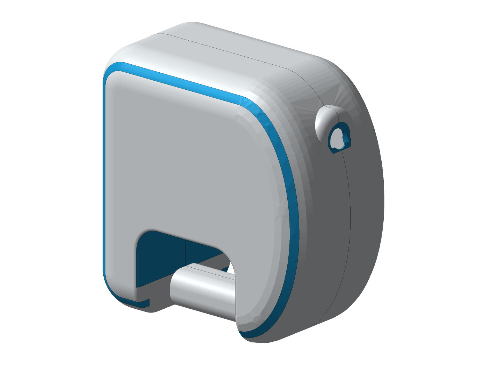
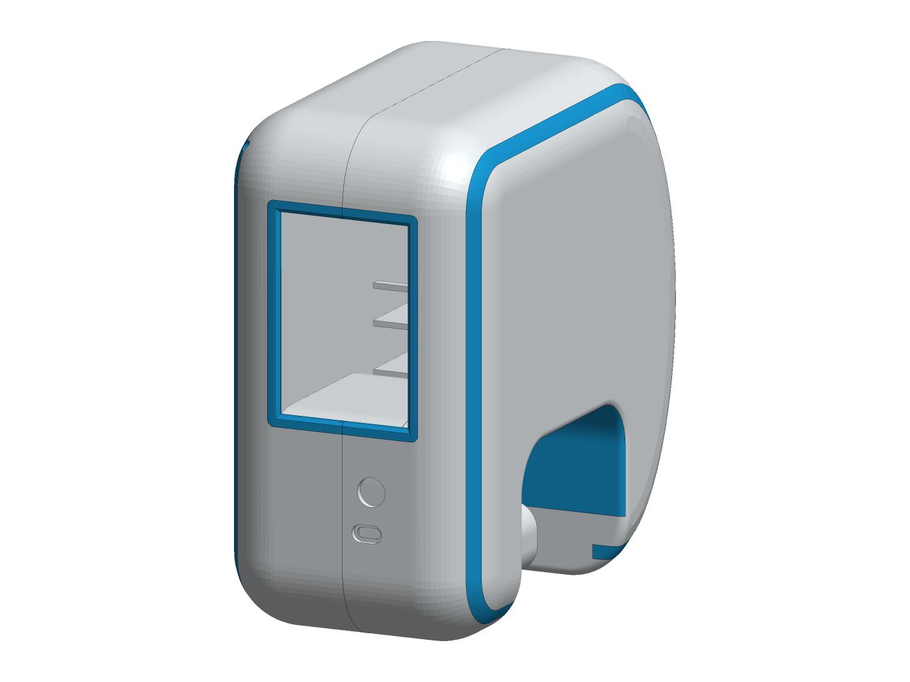
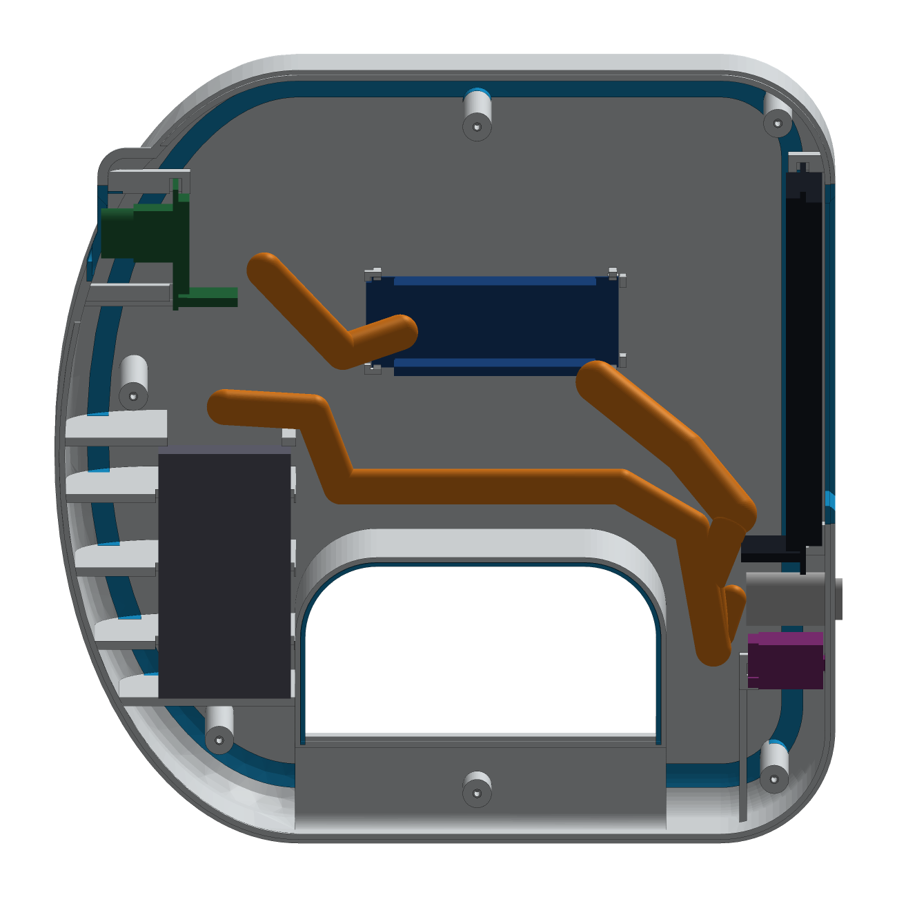
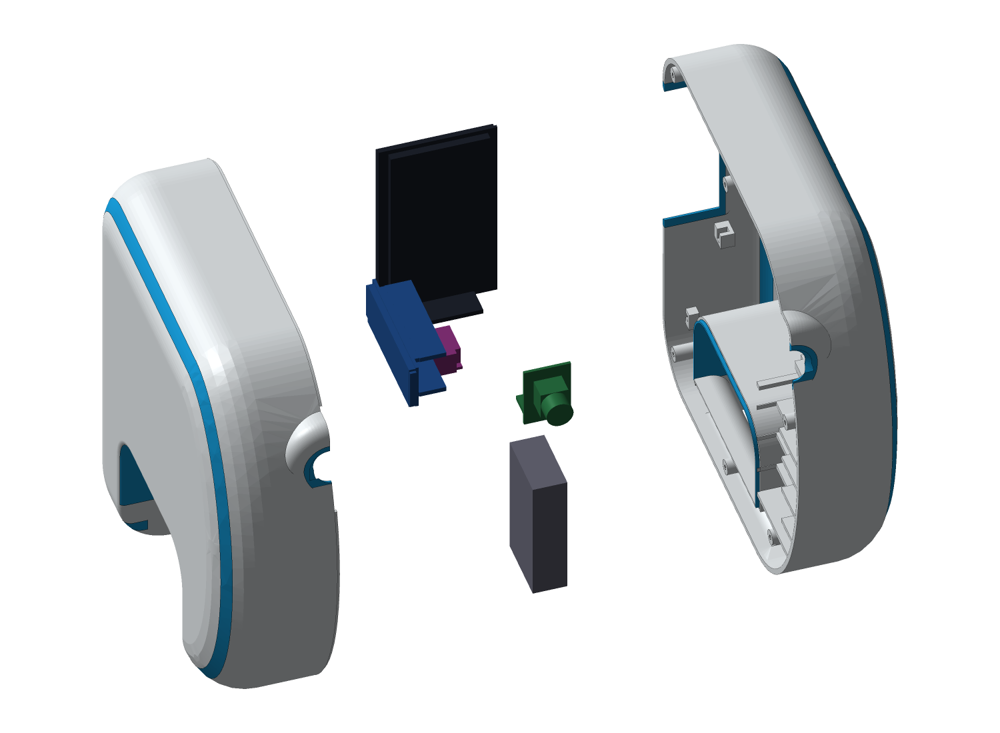

# ARC-22 FitFirst — Subnautica-style handheld scanner

A documented, reproducible open-source build: a two-shell white/blue printed enclosure, a bill of materials, pin-by-pin wiring, CadQuery 3D models, and ESP32-S3 firmware that runs **object detection on the device itself**. The modules seat snug; the Dupont wiring stays free to move.

> **Status:** the CAD model passes its recorded self-checks; **no physical fit, slicing or firmware run has been verified yet** — see [Validation](VALIDATION.md). Measure your parts first.

**[Open ARC-22 Studio](app/)** — the 3D model, your measurements, wiring and build progress in one app. Installable from the browser, or as a [desktop app](APP.md).

## Start here
1. [**Build guide**](BUILD_GUIDE.md) — stages 0 → 7, each with parts, steps, measurements and PASS / FIX / STOP
2. [Measurements](MEASUREMENTS.md) — what to measure on *your* boards, and where to type it
3. [Bill of materials](BOM.md) · [Wiring](WIRING.md) · [Pin-by-pin connections](CONNECTIONS.md) · [Safety](SAFETY.md) · [Requirements](REQUIREMENTS.md)
4. [Two-colour printing on a Bambu Lab P1S](PRINTING.md)
5. [Firmware](FIRMWARE.md) — commission capture first, then local inference
6. [CAD](CAD.md) — how the model reserves space for plugged connectors and wire bends, and how it is checked
7. [ARC-22 Studio app](APP.md) · [Develop](DEVELOP.md) · [Publish](PUBLISH.md)
8. [Validation](VALIDATION.md) · [Security](SECURITY.md) · [Credits](CREDITS.md) · [Glossary](GLOSSARY.md)

## The two goals
**A — snug modules, movable wires.** Every board is modelled with its plugged-in 2.54 mm Dupont housings, the straight wire exit, the first relaxed bend and strain relief. Boards register at verified bare corners on soft foam — never under screw pressure — and the right shell is checked while it *closes* onto the fully wired left half, not just at its final position.

**B — local computer vision.** Point the high front camera, tap **SCAN**: one still photo, object detection on the ESP32-S3 (80 everyday COCO categories), boxes and names on screen, tap one for its Wikipedia intro (Wi-Fi for the lookup only, with QR fallback). It takes several seconds per scan — this is not live video.

| Rear: touch window, power button, USB-C | Inside the LEFT shell |
|---|---|
|  |  |

## Two pieces, two colours
Exactly two prints — LEFT and RIGHT — joined by six M2 screws. Cyan accents (shoulder stripes, window frame, lens ring, hand-loop liner) are separate *material regions* printed in the same job, delivered as aligned STLs, OBJ+MTL, an optional 3MF and editable STEP.

Enclosed is not waterproof: ARC-22 has no Ingress Protection (IP) rating.
