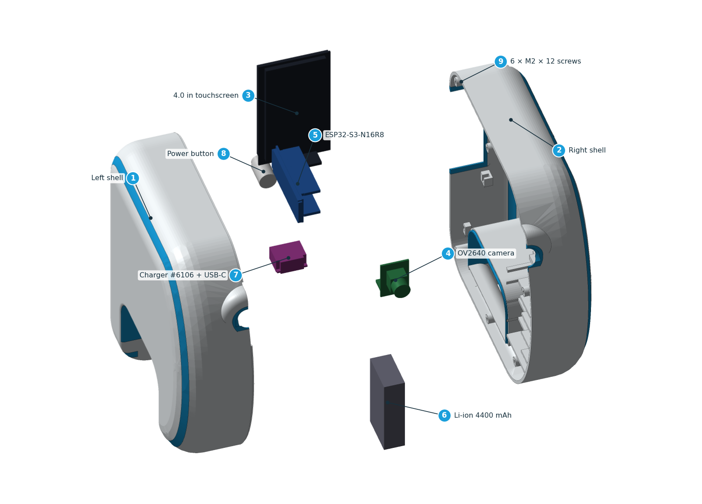

# Manufacturing package

Everything needed to make an ARC-22, from open files. Each release also ships it as one download: **`arc22-manufacturing-<version>.zip`** on the Releases page.

## 1 · What to print
| File | What | Notes |
|---|---|---|
| [`cad/out/fit_samples/`](../cad/out/fit_samples) | 3 fit samples | print first, single colour, 100 % |
| [`cad/out/print/stl/`](../cad/out/print/stl) | `ARC22_LEFT_WHITE` + `ARC22_LEFT_BLUE`, same for RIGHT | load each pair **as one object**, assign white + cyan PETG |
| [`cad/out/print/`](../cad/out/print) | OBJ + MTL, optional 3MF | same geometry, coloured |
| [`cad/out/step/`](../cad/out/step) | STEP (assembly + each shell) | edit in any CAD tool (Onshape, FreeCAD, Fusion) |

Settings and slicer steps: [PRINTING.md](../docs/PRINTING.md).

## 2 · What to buy
[`bom.csv`](bom.csv) — open in any spreadsheet. Readable version: [BOM.md](../docs/BOM.md).

## 3 · How to wire it
| File | What |
|---|---|
| [`connections.csv`](connections.csv) | **the** wire list: every wire, from-pin, to-pin, signal, colour, gauge, cut length |
| [`connectors.yml`](connectors.yml) | pin order of every header, splice and tee |
| [`harness/arc22_harness.svg`](harness/arc22_harness.svg) | full harness drawing (WireViz) — also `.png`, `.html` |
| [`harness/arc22_harness.bom.tsv`](harness/arc22_harness.bom.tsv) | harness parts list |
| [CONNECTIONS.md](../docs/CONNECTIONS.md) | pin-by-pin tables per module |

`python tools/build_mfg.py` regenerates the drawings and tables and **fails** if a wire, a header pin or a pull-up disagrees with the firmware pin map (`firmware/main/pins.h`).

## 4 · How to build, test and flash
[BUILD_GUIDE.md](../docs/BUILD_GUIDE.md) (stages 0–7, PASS / FIX / STOP) · [SAFETY.md](../docs/SAFETY.md) · [FIRMWARE.md](../docs/FIRMWARE.md) · [REQUIREMENTS.md](../docs/REQUIREMENTS.md) · [VALIDATION.md](../docs/VALIDATION.md)

## Licences
Hardware design files: **CERN-OHL-P-2.0** ([LICENSE-HARDWARE](../LICENSE-HARDWARE)) · software: **MIT** ([LICENSE](../LICENSE)) · documentation and images: **CC BY 4.0** ([LICENSE-DOCS](../LICENSE-DOCS)). With these licences and the published sources, the project meets the documentation requirements for an [OSHWA certification](https://certification.oshwa.org/) application, which only the project owner can file.

> Nothing here is physically validated yet — 57 of 60 fit dimensions are reference values. Measure your parts (Stage 0) and print the fit samples before the shells.
